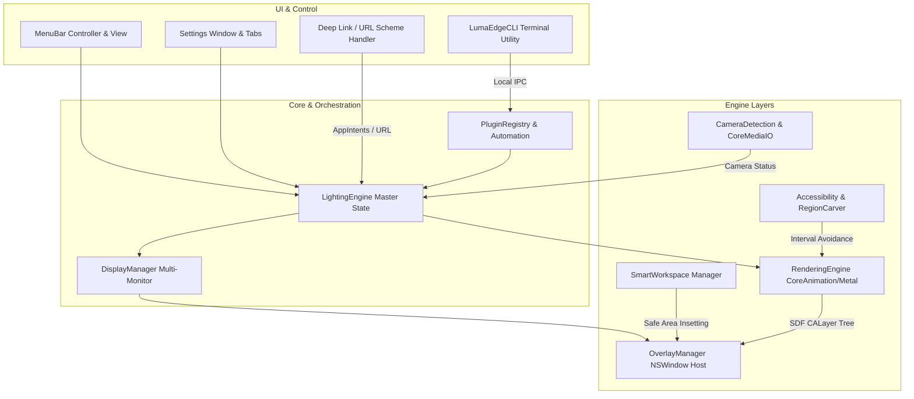

# LumaEdge Technical Architecture

LumaEdge is engineered as a modular, highly performant macOS utility. It leverages native Apple frameworks (`AppKit`, `SwiftUI`, `CoreAnimation`, `CoreMediaIO`, and `Accessibility`) to achieve professional studio lighting simulation on any macOS 14+ system.

---

## High-Level System Architecture



---

## Module Breakdown

### 1. `LumaEdgeCore`
- **Responsibilities**: Houses canonical domain entities (`EdgeSegment`, `GlowPreset`, `VirtualRingPosition`) and `LightingEngine.shared`.
- **Color Science (`KelvinToRGB`)**: Maps Planckian blackbody color temperatures from `2700K` (warm tungsten) to `6500K` (cool daylight) into calibrated sRGB / P3 values, balancing red and blue channels while maintaining true luminance parity.

### 2. `RenderingEngine`
- **Layer Architecture**: Avoids heavy SwiftUI view hierarchies inside high-refresh render loops. Instead, `OverlayHostView` hosts a zero-copy `CALayer` tree:
  - `GlowHostLayer`: Root host managing HDR headroom (`wantsExtendedDynamicRangeContent = true`).
  - `BorderGlowLayer`: Dedicated sublayers for each active screen edge (`.top`, `.bottom`, `.left`, `.right`).
- **Optical Diffusion & Bloom Engine (`CanvasEdgeView` & `SoftSegmentGlow`)**:
  - Employs 4 directional linear falloff gradients (`Bezel Rim`, `Inner Core Highlight Band`, `Studio Diffuser Body Light`, and `Diffuse Ambient Halo`).
  - Uses `smoothstep` end feathering (`3.5%` boundary span) and precise bezel edge anchoring (`0.12x` core scale) to simulate frosted optical glass.

### 3. `DisplayManager` & `OverlayManager`
- **Multi-Monitor Hot-Plugging**: Listens to `CGDisplayRegisterReconfigurationCallback` for display additions, removals, and resolution changes.
- **Window Attributes**: Creates one border overlay `NSWindow` per display with:
  - `.styleMask = [.borderless, .nonactivatingPanel]`
  - `.level = .statusBar + 1` (above normal applications, below system alerts).
  - `.collectionBehavior = [.canJoinAllSpaces, .stationary, .ignoresCycle]`
  - `ignoresMouseEvents = true` (`100% click-through`).

### 4. `CameraDetection`
- **Exact Client Process Gating (`prsn` / `0x7072736e`)**:
  Probes `kCMIODevicePropertyProcessIsRunningSomewhere` across all connected `AVCaptureDevice` instances. Unlike basic boolean checks that trigger false positives when virtual cameras (Continuity Camera, OBS, Desk View) are registered or when `CoreMediaIO` daemons run in standby, LumaEdge parses the exact client PID (`prsn`) structure:
  ```swift
  struct CMIOProcessIsRunningSomewhereData {
      var processID: pid_t
      var isRunningSomewhere: UInt32
  }
  ```
  If no non-daemon user process has an active video stream, `isCameraActive` remains `false`.

### 5. `AccessibilityManager` & `RegionCarver`
- **Layered Avoidance**:
  - `AXUIInspector`: Queries `AXUIElement` hierarchy for active scrollbars, system menu bars, and full-screen media players.
  - `RegionCarver`: Given an initial `EdgeSegment` interval (`[startFraction, endFraction]`), subtracts overlapping UI cutout bounds (`CutoutInterval`) and emits clean, non-overlapping `EdgeSegment` chunks for rendering.

### 6. `PluginAPI` & Local IPC
- **Local IPC without Network Overhead**: Communicates over `DistributedNotificationCenter.default()` using custom payload keys (`LumaEdgeIPCCommand`). Zero TCP/UDP ports or loopback sockets are opened, keeping LumaEdge 100% sandboxed and firewall-friendly.
- **Built-in Plugins**:
  - `TimeOfDayPlugin`: Shifts color temperature smoothly across the day.
  - `AdaptiveBrightnessPlugin`: Dims edge lighting when MacBook switches from AC power to battery.

---

## Concurrency & Performance Guarantees
- Compiled under **Swift 6 Concurrency** mode.
- State mutation is serialized via `@MainActor` on UI controllers and isolated `Sendable` structs passed across module boundaries.
- Render pass CPU budget: `< 1%` CPU utilization during active video calls at `60FPS / 120FPS ProMotion`.
